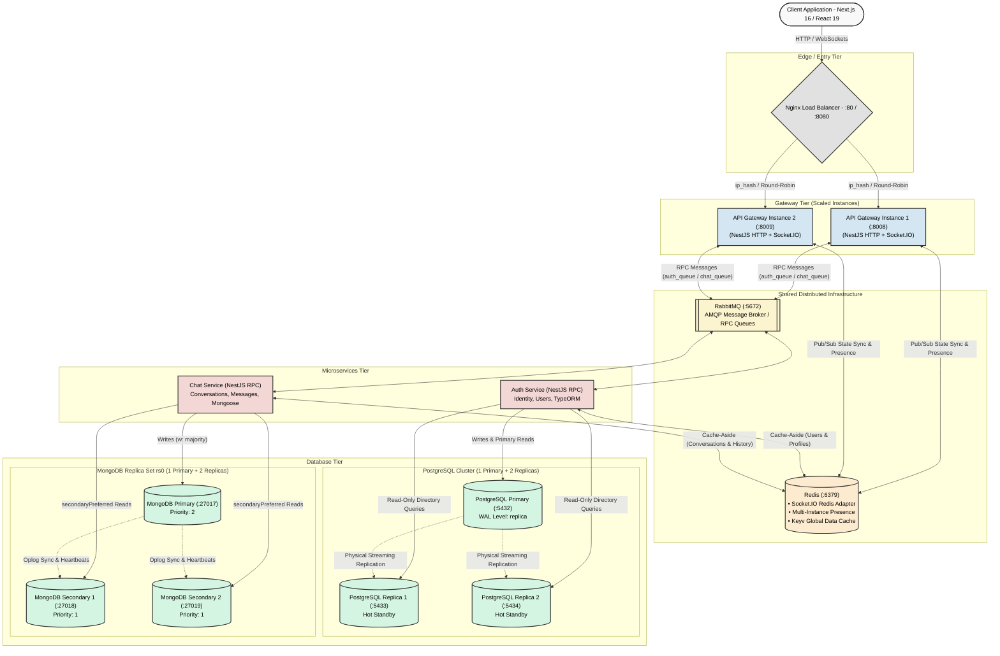
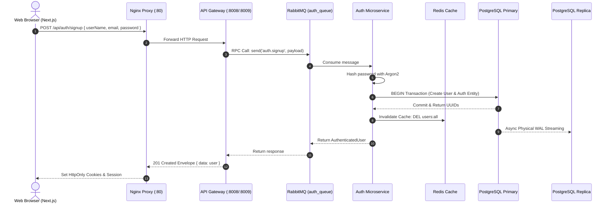
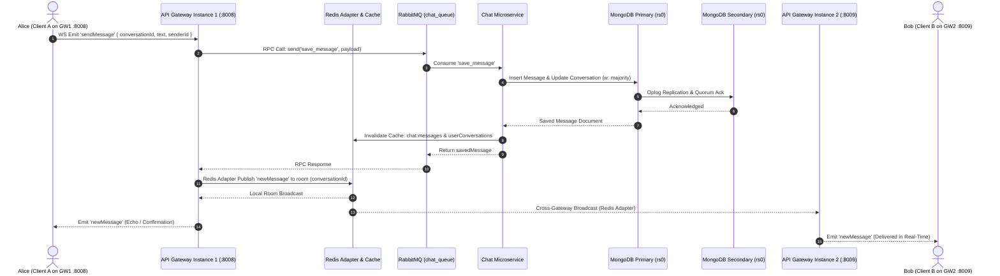
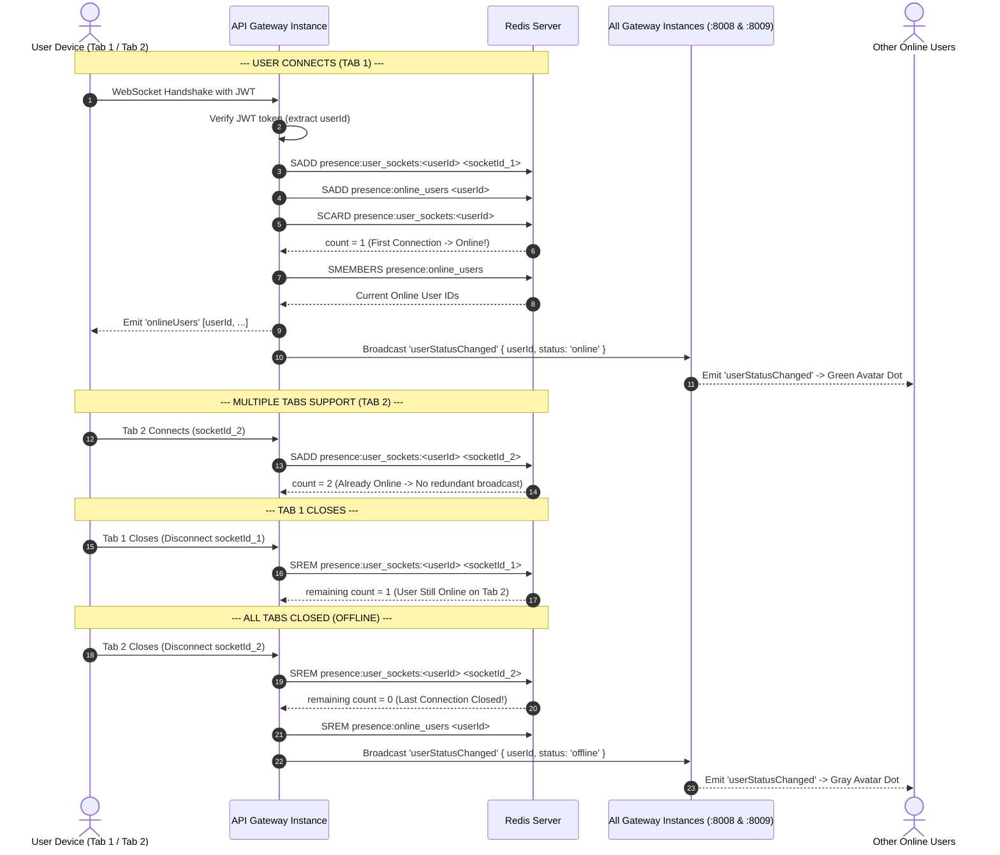
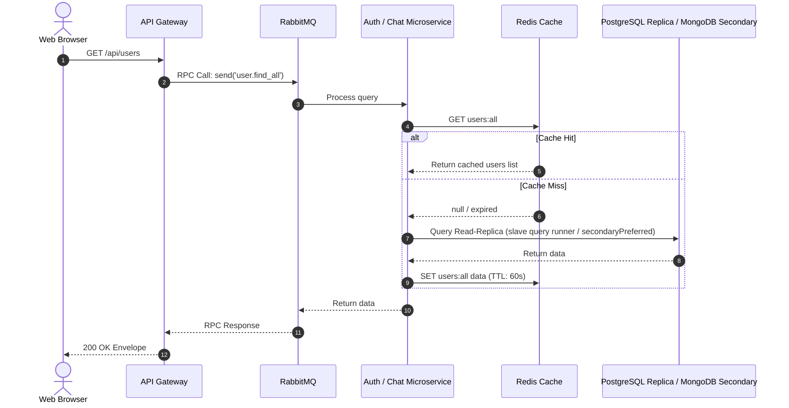
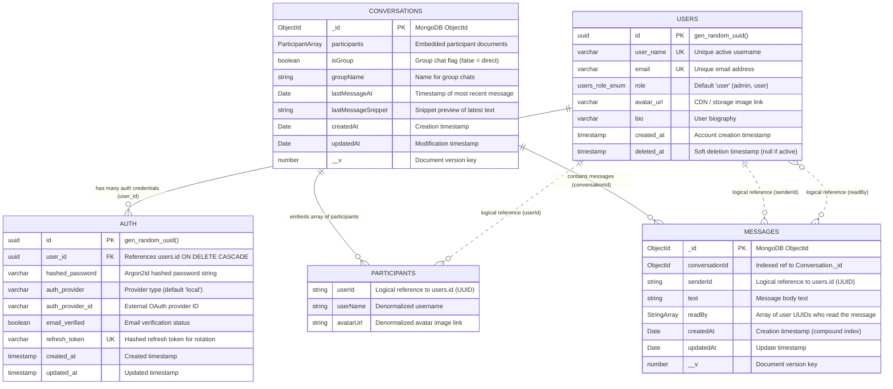

# Distributed Systems Architecture Report & Evaluation

## 1. Executive Verdict: Is This Project a Distributed System?

> [!IMPORTANT]
> **Answer: YES, this project is definitely a Distributed System.**
> It fulfills the formal definition established by Leslie Lamport and Coulouris et al.: _"A system in which hardware or software components located at networked computers communicate and coordinate their actions only by passing messages."_

The architecture is not a monolithic application; it is a **multi-tier, loosely-coupled, distributed microservices and replicated data system** with distinct failure domains, asynchronous message brokers, load-balanced multi-instance gateways, distributed caching, and multi-node replicated data stores.

---

## 2. Distributed Architecture Overview

---

## 3. End-to-End Distributed Workflows

### Workflow 1: Authentication & Token Rotation (Cache Invalidation & Primary Write)

Demonstrates the write path for authentication, password hashing, transaction boundaries, and Redis cache invalidation.

---

### Workflow 2: Cross-Gateway Real-Time Messaging & Distributed Synchronization

Illustrates how two users connected to completely different API Gateway instances exchange real-time messages via Redis Pub/Sub adapter and MongoDB majority persistence.

---

### Workflow 3: Multi-Instance Real-Time Online/Offline Presence Tracking

Demonstrates how presence state is synchronized across nodes using Redis Sets when clients connect, open multiple tabs, or disconnect.

---

### Workflow 4: Distributed Cache-Aside & Replica Read Path

Demonstrates how read queries for the user directory or conversation history bypass the primary database.

---

## 4. Entity-Relationship Design (ERD)

The system employs **Polyglot Persistence**:

- **PostgreSQL**: Relational integrity for user identities, credentials, role-based access control, and soft deletion. Primary keys are UUIDs (`gen_random_uuid()`).
- **MongoDB**: Flexible JSON documents for nested conversation participants, unread receipts, and chat message streams.

### Database Entities & Schema Deep Dive

#### 1. PostgreSQL Relational Schemas (`apps/auth-service`)

- **`users` Table**:
  - `id` (`uuid`, PK): Primary identifier using PostgreSQL native `gen_random_uuid()`.
  - `user_name` & `email`: Enforced unique constraints and indexed. Partial index `idx_active_users_username` filters out soft-deleted users (`deleted_at IS NULL`).
  - `role`: Native PostgreSQL enum `users_role_enum ('admin', 'user')`.
  - `deleted_at`: Soft-deletion timestamp. Allows account recovery and historical audit without cascading destructive deletes.
- **`auth` Table**:
  - `id` (`uuid`, PK): Unique credential record ID.
  - `user_id` (`uuid`, FK): Foreign key referencing `users.id` with `ON DELETE CASCADE`.
  - `hashed_password`: Stored as high-entropy Argon2id hash (`$argon2id$v=19$m=65536,t=3,p=4$...`).
  - Composite unique constraints: `UNIQUE (user_id, auth_provider)` and `UNIQUE (auth_provider, auth_provider_id)` guarantee credential integrity.
  - `refresh_token`: Indexed unique column for JWT refresh token rotation.

#### 2. MongoDB Document Schemas (`apps/chat-service`)

- **`conversations` Collection**:
  - Multikey index on `participants.userId` allows $O(1)$ discovery of all conversations involving a user.
  - `isGroup`: Differentiates direct messages from group chats.
  - Denormalized `lastMessageSnippet` and `lastMessageAt` avoid multi-document lookups for the chat sidebar.
- **Embedded `participants` Sub-document**:
  - Embedded directly inside `conversations` with `_id: false` to eliminate JOIN operations across collections.
  - Stores `userId` (logical UUID), `userName`, and `avatarUrl` for instantaneous UI rendering.
- **`messages` Collection**:
  - Compound index `{ conversationId: 1, createdAt: -1 }` guarantees rapid pagination of chat history from latest to oldest.
  - `readBy`: Array of UUID strings indicating read receipts.

---

## 5. Core Distributed Systems Criteria Analysis

| Distributed System Pillar                          | How It Is Implemented In This Project                                                                                                                                                                                                                                                             | Distributed Characteristic                                               |
| :------------------------------------------------- | :------------------------------------------------------------------------------------------------------------------------------------------------------------------------------------------------------------------------------------------------------------------------------------------------ | :----------------------------------------------------------------------- |
| **1. Concurrency & Network Communication**         | Services run as independent OS processes/containers communicating over TCP/IP via HTTP, WebSockets, AMQP (RabbitMQ), and Redis protocol.                                                                                                                                                          | **No shared memory**; interaction occurs purely via message passing.     |
| **2. Horizontal Scaling & Load Balancing**         | Nginx sits in front of twin API Gateway instances (`:8008` and `:8009`), routing HTTP traffic and upgrading WebSocket connections using `ip_hash`.                                                                                                                                                | Load distribution across multiple gateway instances.                     |
| **3. Message-Oriented Middleware (MOM)**           | Gateway forwards client actions to microservices using RabbitMQ (`auth_queue` and `chat_queue`) over RPC pattern (`send/firstValueFrom`).                                                                                                                                                         | Decoupled execution, message buffering, and service discovery.           |
| **4. Distributed State & Multi-Node Coordination** | Multi-instance WebSockets use `@socket.io/redis-adapter` for pub/sub cross-node event broadcasting. Presence is tracked across nodes using Redis Sets (`presence:online_users` and `presence:user_sockets:<userId>`).                                                                             | State synchronization across independent server nodes.                   |
| **5. Distributed Caching & Cache-Aside**           | Global Redis cache (`@nestjs/cache-manager` + `@keyv/redis`) with cache invalidation across services on write mutations.                                                                                                                                                                          | Reduced latency and shared memory offloading across distributed workers. |
| **6. Database Replication & Read Distribution**    | • **PostgreSQL**: Primary-Standby physical WAL streaming replication (`max_wal_senders=10`, `hot_standby=on`). Write queries go to Master; directory reads query Slave runner. • **MongoDB**: 2-node Replica Set (`rs0`) with primary election, oplog replication, and keyfile authentication. | Redundancy, write-master/read-replica topology.                          |
| **7. Heterogeneous Polyglot Persistence**          | Relational data (Users, Auth credentials) in PostgreSQL; document/chat data (Conversations, Messages) in MongoDB; transient session state in Redis.                                                                                                                                               | Polyglot persistence tailored to data models.                            |
| **8. Independent Failure Domains**                 | A crash of `chat-service` does not bring down `auth-service` or the HTTP Gateway. Messages remain queued in RabbitMQ until the service recovers.                                                                                                                                                  | Partial failure tolerance.                                               |

---

## 6. Theoretical Analysis for Academic / Technical Report

### A. CAP Theorem Mapping

- **PostgreSQL Layer (AP / CP Boundary)**:
  - Configured with **asynchronous streaming replication**.
  - TypeORM directs writes to the primary and specific reads to the replica.
  - During network partition between primary and standby, the primary continues accepting writes (**High Availability for writes**), trading off strict real-time consistency on the replica (Eventual Consistency / replication lag).
- **MongoDB Layer (Tunable CP System)**:
  - Uses `writeConcern: { w: 'majority', wtimeoutMS: 10000 }` and retryable writes.
  - In a partition or split-brain, writes are rejected if a quorum cannot acknowledge the write, favoring **Consistency** over Availability.
- **Redis & Gateway (AP System)**:
  - In-memory presence and pub/sub favor instant availability and low latency over strict linearizability.

### B. Fallacies of Distributed Computing Addressed

1. **"The network is reliable"**: Addressed via RabbitMQ durable queues, reconnection logic, Redis connection retry, and MongoDB retryable writes (`retryWrites: true`).
2. **"Latency is zero"**: Addressed via Redis caching layer (`CACHE_TTL`, Cache-Aside pattern) to minimize redundant database round-trips.
3. **"Topology doesn't change"**: Addressed by Nginx upstream abstraction (`api_gateway` server group) and RabbitMQ queue routing keys.

---

## 7. What Makes It a Distributed System vs. What Can Be Enhanced

### What Is Already Fully Distributed:

- Microservices decoupled by Message Broker (RabbitMQ RPC).
- Horizontally scaled gateway tier behind a reverse proxy (Nginx).
- Multi-instance WebSocket synchronization through Redis pub/sub.
- Distributed user presence across instances using Redis sets.
- Multi-node database replication (PostgreSQL WAL streaming + MongoDB Replica Set).
- Shared distributed cache (Redis).

### Optional Recommendations / Enhancements (To Mention in Future Work of Your Report):

1. **Automated Database Failover**:
   - Currently, PostgreSQL replication is standby read-replica with manual promotion (documented in `docs/database-replication.md`). Adding an orchestrator like **Patroni** or **pg_auto_failover** would bring automated leader election.
   - For MongoDB, adding an **Arbiter** or 3rd data member would allow 1-node failure tolerance without losing write quorum (since 2 nodes require 2/2 votes for majority).
2. **Distributed Tracing & Observability**:
   - Introduce **OpenTelemetry**, **Jaeger**, or correlation IDs (`X-Correlation-ID`) across HTTP Gateway -> RabbitMQ message headers -> Microservices to trace requests end-to-end.
3. **Centralized Service Discovery**:
   - Adding a service registry (e.g. Consul or Kubernetes DNS) if deploying beyond Docker Compose.
4. **Resilience & Circuit Breaking**:
   - Integrate circuit breaker patterns (e.g., using `opossum` or NestJS interceptors) when downstream RPC or Redis calls experience timeout spikes.

---

## 9. Report Template Snippet (Ready to Copy)

> ### System Architecture Overview (For Report)
>
> \*"The developed social media platform is designed as a distributed, service-oriented architecture (SOA). The presentation layer is built with Next.js 16 and React 19. Incoming HTTP and WebSocket connections are load-balanced via an Nginx reverse proxy using IP-hashing to distribute requests across multiple stateless API Gateway instances. Communication between the edge gateway and internal business microservices (Authentication and Chat) is decoupled through RabbitMQ message-oriented middleware using asynchronous RPC queues.
>
> Cross-gateway WebSocket state and online presence are coordinated in real-time through a Redis pub/sub adapter and distributed in-memory sets. Persistence employs a distributed polyglot model: relational identity management is backed by a PostgreSQL cluster with primary-standby WAL streaming replication, while conversation and message history is managed by a MongoDB replica set (rs0) enforcing majority write concerns. A distributed Redis cache-aside layer is integrated across services to reduce read latency and maintain high throughput."\*
