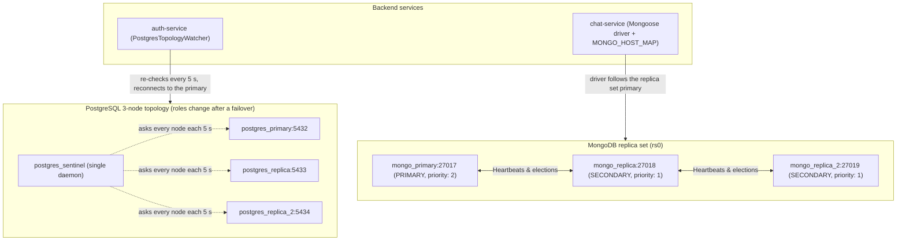

# Database Failover & Replica Promotion Simulation Guide

This guide gives test scenarios, verification commands and an automated script to simulate a primary database failure, watch the automatic promotion, and check that no committed data is lost and the old primary rejoins safely. Everything here stops or isolates real containers: use a development stack only.

The commands use `docker compose exec` with the default `postgres` user and database. If your `.env` sets other `DB_USER` or `DB_NAME` values, use those instead.

---

## Architecture Overview



How the PostgreSQL side behaves is described in [database-replication.md](database-replication.md#postgresql-automatic-failover--promotion).

---

## SCENARIO 1: MongoDB Primary Failure & Automatic Election

MongoDB handles election natively: when the primary goes down, the two surviving members hold a majority (2 of 3) and elect a new primary. The `chat-service` driver follows the new primary; writes fail for a short time during the election (about 10 to 12 seconds when measured).

### Step 1: Check the state before the crash

```bash
docker compose exec mongo_primary sh -c 'mongosh --quiet -u "$MONGO_INITDB_ROOT_USERNAME" -p "$MONGO_INITDB_ROOT_PASSWORD" --authenticationDatabase admin --eval "rs.status().members.map(m => m.name + \" \" + m.stateStr).join(\", \")"'
```

_Expected output:_ `mongo_primary:27017 PRIMARY, mongo_replica:27018 SECONDARY, mongo_replica_2:27019 SECONDARY`

### Step 2: Stop the primary

```bash
docker compose stop mongo_primary
```

### Step 3: Observe the election

Query a surviving member (`mongo_replica`). Its container has no credentials in its environment (only `mongo_primary` has them) and `mongo_primary` is stopped, so use `MONGO_USER` and `MONGO_PASS` from your `.env`:

```bash
docker compose exec mongo_replica mongosh --quiet --port 27018 -u <MONGO_USER> -p <MONGO_PASS> --authenticationDatabase admin --eval "rs.status().members.map(m => m.name + ' ' + m.stateStr + ' health=' + m.health).join(', ')"
```

_Result:_ `mongo_primary:27017` has `health=0`, and one of `mongo_replica:27018` or `mongo_replica_2:27019` is now `PRIMARY`.

### Step 4: Check that the application keeps working

Send a message from the web app. It may report "Not sent" for the first 10 to 12 seconds, then succeed (use the Retry button). For a timed run, use the measurement script: `node report/scripts/f4_f6_infra.mjs mongo 40000`.

### Step 5: Recover the old primary

```bash
docker compose start mongo_primary
```

The old primary catches up from the oplog and rejoins as a `SECONDARY` (or takes the primary role back, because of its higher priority).

---

## SCENARIO 2: PostgreSQL Primary Crash

The **`postgres_sentinel`** daemon watches all three nodes. Because any node can be the primary after a failover, first find out which one it is.

### Step 1: Find the current roles

```bash
docker compose exec -T postgres_primary psql -U postgres -d postgres -tAc "SELECT pg_is_in_recovery();"
docker compose exec -T postgres_replica psql -U postgres -d postgres -tAc "SELECT pg_is_in_recovery();"
docker compose exec -T postgres_replica_2 psql -U postgres -d postgres -tAc "SELECT pg_is_in_recovery();"
```

`f` is the read-write primary and `t` is a read-only standby. The commands below assume `postgres_primary` is the primary; if another node is, swap the names. Check that the primary has two streaming standbys:

```bash
docker compose exec -T postgres_primary psql -U postgres -d postgres -tAc "SELECT application_name, state FROM pg_stat_replication;"
```

### Step 2: Write a marker row

```bash
docker compose exec -T postgres_primary psql -U postgres -d postgres -c "CREATE TABLE IF NOT EXISTS failover_probe (id serial PRIMARY KEY, at timestamptz DEFAULT now()); INSERT INTO failover_probe DEFAULT VALUES; SELECT count(*) FROM failover_probe;"
```

### Step 3: Follow the sentinel and stop the primary

In a second terminal:

```bash
docker compose logs -f postgres_sentinel
```

Then stop the primary:

```bash
docker compose stop postgres_primary
```

### Step 4: Observe the promotion

After 3 failed rounds (5 s apart) and the promotion itself, usually 23 to 26 seconds in total, the sentinel logs:

```log
No reachable primary (previous: postgres_primary), round 3/3
FAILOVER: promoting postgres_replica (WAL position ...) among: postgres_replica postgres_replica_2
Failover complete: new primary is postgres_replica
Standby postgres_replica_2 now follows postgres_replica (slot: auth_replica_2)
```

The sentinel promotes the standby that has received the most WAL, so it may pick `postgres_replica_2` instead.

### Step 5: Check that no data was lost and writes work

On the node that was promoted (here `postgres_replica`):

```bash
docker compose exec -T postgres_replica psql -U postgres -d postgres -c "SELECT count(*) FROM failover_probe; INSERT INTO failover_probe DEFAULT VALUES;"
```

The count must equal the one from step 2, and the insert must succeed. The other standby must follow the new primary:

```bash
docker compose exec -T postgres_replica psql -U postgres -d postgres -tAc "SELECT application_name, state FROM pg_stat_replication;"
```

### Step 6: Check that `auth-service` followed

`auth-service` logs `Primary changed from ... reconnecting` and `Reconnected to the new primary ...` within 5 seconds of the promotion, and sign-in works again.

### Step 7: Bring the old primary back

```bash
docker compose start postgres_primary
```

The old primary finds a primary with a newer timeline, discards its data directory, clones itself from the new primary and starts as a standby (about 2 seconds with this small dataset). Confirm:

```bash
docker compose exec -T postgres_primary psql -U postgres -d postgres -tAc "SELECT pg_is_in_recovery();"
docker compose exec -T postgres_replica psql -U postgres -d postgres -tAc "SELECT application_name, state FROM pg_stat_replication;"
```

_Expected:_ `t`, and two `streaming` standbys on the new primary. The cluster does not switch back by itself: `postgres_replica` stays the primary.

### Step 8: Clean up the marker table

On the current primary:

```bash
docker compose exec -T postgres_replica psql -U postgres -d postgres -c "DROP TABLE IF EXISTS failover_probe;"
```

---

## SCENARIO 3: Network Partition and Fencing of the Old Primary

A crashed primary cannot do harm. A primary that is only cut off from the network keeps running and stays writable, so it must be fenced when it comes back.

### Step 1: Cut the primary off

Find the network and the container name, then disconnect it:

```bash
docker network disconnect messenger-clone-microservice_default auth_postgres
```

(`auth_postgres` is the container of `postgres_primary`; the other nodes are `messenger-clone-microservice-postgres_replica-1` and `messenger-clone-microservice-postgres_replica_2-1`. The network name is `<project>_default`; `docker network ls` lists it.)

The sentinel promotes a standby after about 24 seconds, as in scenario 2.

### Step 2: Reconnect it with its aliases

```bash
docker network connect --alias postgres_primary --alias auth_postgres messenger-clone-microservice_default auth_postgres
```

Without `--alias` the node loses the DNS names the other nodes use. For a few seconds two nodes report `f`. Watch the sentinel log:

```log
SPLIT BRAIN: primaries are postgres_primary postgres_replica; keeping postgres_replica
FENCING postgres_primary: postgres_replica is the legitimate primary; shutting postgres_primary down
```

Docker restarts the fenced container, which re-clones itself as a standby. After about 5 seconds only one node reports `f`.

---

## SCENARIO 4: Only the Sentinel Loses Sight of the Primary

If the sentinel cannot reach a healthy primary, promoting a standby would create two primaries. The sentinel therefore asks the standbys first: if one still streams from a primary, it does not promote.

Block only the sentinel's route to the current primary (the `netem-tools` image is the local one used by `report/scripts/netem.sh`: Alpine with `iproute2`):

```bash
SEN=$(docker compose ps -q postgres_sentinel)
IP=$(docker inspect -f '{{range .NetworkSettings.Networks}}{{.IPAddress}}{{end}}' "$(docker compose ps -q postgres_replica)")
docker run --rm --net container:$SEN --cap-add NET_ADMIN netem-tools ip route add blackhole $IP/32
```

(Use the service that is the primary instead of `postgres_replica` if it is another one.) The log shows, every 5 seconds:

```log
No reachable primary (previous: postgres_replica), round 4/3
Not failing over: standby postgres_primary is still streaming from a primary (sentinel may be isolated)
```

Remove the block:

```bash
docker run --rm --net container:$SEN --cap-add NET_ADMIN netem-tools ip route del blackhole $IP/32
```

---

## Automated Script for a Fast Demo

`scripts/simulate-failover.ps1` runs scenarios 2 and 3 end to end without assuming which node is the primary. Each round it writes a marker row, takes the primary out, waits for the new primary, checks that no row was lost, brings the old primary back, waits until it streams again and checks that all three nodes hold the same rows. It exits with code 1 if any check fails.

```powershell
# one crash and recovery
powershell -ExecutionPolicy Bypass -File scripts\simulate-failover.ps1

# three crashes in a row (the primary role moves between nodes)
powershell -ExecutionPolicy Bypass -File scripts\simulate-failover.ps1 -Rounds 3

# network partition: the old primary comes back writable and must be fenced
powershell -ExecutionPolicy Bypass -File scripts\simulate-failover.ps1 -Mode Partition
```

A run takes about 1 to 2 minutes per round. Writes (sign-in, registration) fail for roughly 25 seconds in each round.
