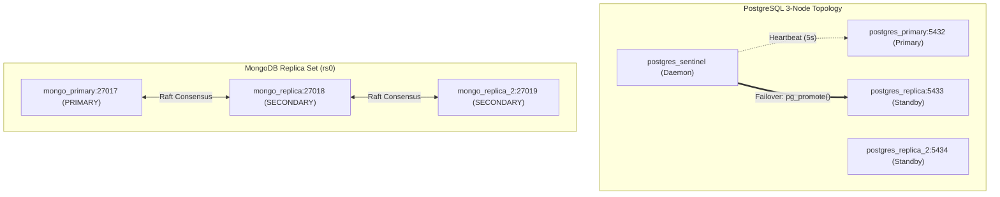

# Database Failover & Replica Promotion Simulation Guide

This guide provides test scenarios, commands, and scripts to simulate primary database failure, observe automated election/promotion, and verify that the application remains functional.

---

## Architecture Overview



---

## SCENARIO 1: MongoDB Primary Failure & Automatic Promotion

MongoDB handles election and failover **100% natively** via Raft-like consensus. When the primary goes down, the remaining secondaries form a quorum ($2/3$) and automatically elect a new primary. Drivers dynamically discover the new primary without restarting your app.

### Step 1: Check Current State Before Crash

```bash
docker compose exec mongo_primary mongosh -u admin -p password --authenticationDatabase admin --eval "rs.status().members.map(m => ({ name: m.name, stateStr: m.stateStr }))"
```

_Expected Output:_

```json
[
  { "name": "mongo_primary:27017", "stateStr": "PRIMARY" },
  { "name": "mongo_replica:27017", "stateStr": "SECONDARY" },
  { "name": "mongo_replica_2:27017", "stateStr": "SECONDARY" }
]
```

### Step 2: Simulate Primary Node Crash

Stop the `mongo_primary` container:

```bash
docker compose stop mongo_primary
```

### Step 3: Observe Automatic Election & Promotion

Query one of the surviving secondaries (`mongo_replica` on port 27018):

```bash
docker compose exec mongo_replica mongosh -u admin -p password --authenticationDatabase admin --eval "rs.status().members.map(m => ({ name: m.name, stateStr: m.stateStr, health: m.health }))"
```

_Result:_

- `mongo_primary:27017` is marked `health: 0` (unreachable).
- One of the surviving nodes (`mongo_replica` or `mongo_replica_2`) is automatically promoted to **`PRIMARY`**!
- Mongoose in `chat-service` reconnects to the new primary automatically.

### Step 4: Recover Primary (Rejoins as Secondary)

```bash
docker compose start mongo_primary
```

The old primary restarts, catches up from the oplog, and rejoins the cluster as `SECONDARY`.

---

## SCENARIO 2: PostgreSQL Primary Failure & Automated Promotion

PostgreSQL streaming replication is monitored by the **`postgres_sentinel`** container daemon.

### Step 1: Verify Initial Replication State

Check `pg_is_in_recovery()` across all 3 nodes:

```bash
# Primary should return 'f' (false = read-write)
docker compose exec postgres_primary psql -U postgres -d postgres -tAc "SELECT pg_is_in_recovery();"

# Standby 1 should return 't' (true = read-only replica)
docker compose exec postgres_replica psql -U postgres -d postgres -tAc "SELECT pg_is_in_recovery();"

# Standby 2 should return 't' (true = read-only replica)
docker compose exec postgres_replica_2 psql -U postgres -d postgres -tAc "SELECT pg_is_in_recovery();"
```

### Step 2: Open Sentinel Monitor Logs in Real Time

In a separate terminal window, follow the sentinel daemon logs:

```bash
docker compose logs -f postgres_sentinel
```

### Step 3: Simulate Primary Node Crash

Kill `postgres_primary`:

```bash
docker compose stop postgres_primary
```

### Step 4: Observe Automatic Standby Promotion

Watch the `postgres_sentinel` terminal. Within 15 seconds (3 failed health probes at 5s intervals), sentinel will trigger promotion:

```log
Warning: Primary postgres_primary health check failed (Count: 1 / 3).
Warning: Primary postgres_primary health check failed (Count: 2 / 3).
Warning: Primary postgres_primary health check failed (Count: 3 / 3).
[2026-11-21T...] Primary postgres_primary is down! Initiating automatic failover...
============================================================
ATTEMPTING AUTOMATIC PROMOTION OF: postgres_replica
============================================================
SUCCESS: postgres_replica is now promoted to PRIMARY (pg_is_in_recovery() = false)!
Failover complete. New primary is postgres_replica.
```

### Step 5: Verify the Promoted Node Accepts Writes

Check the recovery status on `postgres_replica`:

```bash
docker compose exec postgres_replica psql -U postgres -d postgres -tAc "SELECT pg_is_in_recovery();"
```

_Expected output:_ **`f`** (`false` — node is now an active read-write PRIMARY).

Insert a test record directly into the promoted node:

```bash
docker compose exec postgres_replica psql -U postgres -d postgres -c "CREATE TABLE IF NOT EXISTS failover_test (id serial, created_at timestamp default now()); INSERT INTO failover_test DEFAULT VALUES; SELECT * FROM failover_test;"
```

Now turn the primary node online

```bash
docker compose start postgres_primary
```

Check recovery status of primary node

```bash
docker compose exec postgres_primary psql -U postgres -d postgres -tAc "SELECT pg_is_in_recovery();"
```

_Expected output:_ **`t`** (`true` — node is now an active read-only).
