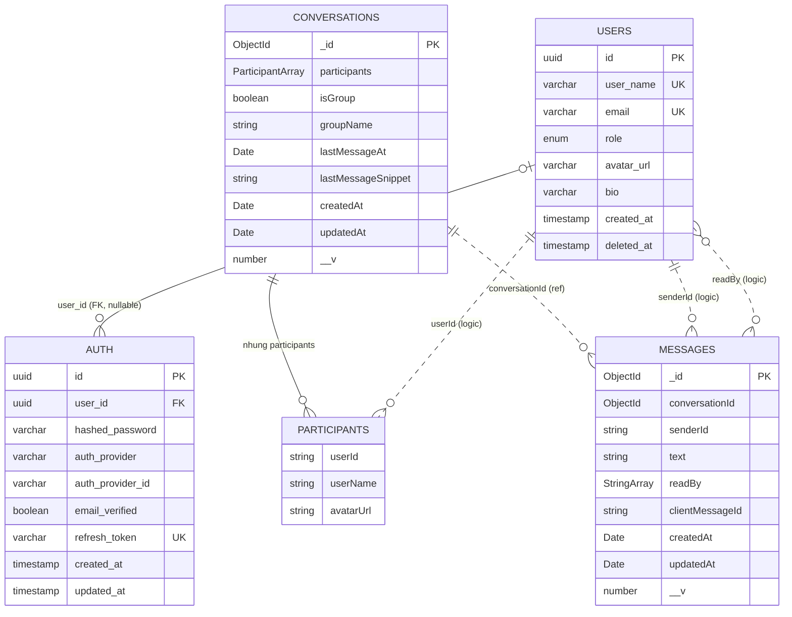

# Thiết kế cơ sở dữ liệu

Tài liệu mô tả mô hình đang được khai báo trong `auth.entity.ts`, `user.entity.ts` và các schema thuộc `chat-service/src/database/schemas/`.

## 1. Thiết kế tổng quát

Hệ thống sử dụng PostgreSQL (TypeORM) cho dịch vụ xác thực và MongoDB (Mongoose) cho dịch vụ trò chuyện. Tên collection MongoDB dưới đây theo quy tắc đặt tên mặc định của Mongoose vì schema không cấu hình tên collection riêng.

| Tên bảng / collection  | Hệ quản trị | Mô tả                                                                                                                                                   |
| ---------------------- | ----------- | ------------------------------------------------------------------------------------------------------------------------------------------------------- |
| `users`                | PostgreSQL  | Lưu hồ sơ người dùng, email, vai trò và trạng thái xóa mềm.                                                                                             |
| `auth`                 | PostgreSQL  | Lưu phương thức xác thực của người dùng, mật khẩu đã băm, thông tin nhà cung cấp và refresh token. Một người dùng có thể có nhiều phương thức xác thực. |
| `conversations`        | MongoDB     | Lưu cuộc trò chuyện cá nhân hoặc nhóm, danh sách thành viên và thông tin tóm tắt tin nhắn gần nhất.                                                     |
| `messages`             | MongoDB     | Lưu nội dung tin nhắn, cuộc trò chuyện, người gửi và danh sách người đã đọc.                                                                            |
| `participants` (nhúng) | MongoDB     | Mảng document con trong `conversations`, lưu ID, tên và ảnh đại diện của thành viên; không phải collection độc lập.                                     |

### Sơ đồ quan hệ

**Quy ước:** `PK` là khóa chính; `FK` là khóa ngoại PostgreSQL; `UK` là ràng buộc duy nhất trên một trường. Các ràng buộc duy nhất tổ hợp được liệt kê ở phần chi tiết. `_id` là định danh duy nhất của document MongoDB.

Đường nét đứt biểu diễn tham chiếu logic, không phải khóa ngoại được cơ sở dữ liệu kiểm tra. `ref: 'Conversation'` hỗ trợ Mongoose tham chiếu model, không bảo đảm document đích tồn tại. Quan hệ từ `users` sang MongoDB mô tả ý nghĩa của các ID; không có ràng buộc liên cơ sở dữ liệu hoặc xóa dây chuyền tự động.

## 2. Thiết kế chi tiết từng bảng

### 2.1. Bảng `users`

Lưu tài khoản và hồ sơ người dùng. Tên cột bên dưới là tên thực tế được khai báo cho PostgreSQL.

| Tên cột      | Kiểu dữ liệu            | Cho phép NULL | Mặc định / tự động      | Mô tả và ràng buộc                                                                   |
| ------------ | ----------------------- | ------------- | ----------------------- | ------------------------------------------------------------------------------------ |
| `id`         | `uuid`                  | Không         | `uuid_generate_v4()`    | Khóa chính của người dùng.                                                           |
| `user_name`  | `varchar`               | Không         | Không khai báo          | Tên người dùng; duy nhất. Thuộc tính TypeScript: `userName`.                         |
| `email`      | `varchar`               | Không         | Không khai báo          | Email người dùng; duy nhất.                                                          |
| `role`       | `enum('admin', 'user')` | Không         | `'user'`                | Vai trò theo enum `Role` trong `packages/types/src/index.ts`.                        |
| `avatar_url` | `varchar`               | Có            | Không khai báo          | URL ảnh đại diện. Thuộc tính TypeScript: `avatarUrl`.                                |
| `bio`        | `varchar`               | Có            | Không khai báo          | Giới thiệu của người dùng.                                                           |
| `created_at` | `timestamp`             | Không         | TypeORM quản lý khi tạo | Thời điểm tạo tài khoản. Thuộc tính TypeScript: `createdAt`.                         |
| `deleted_at` | `timestamp`             | Có            | Chưa xóa: `NULL`        | Thời điểm xóa mềm do `DeleteDateColumn` quản lý. Thuộc tính TypeScript: `deletedAt`. |

**Chỉ mục và quan hệ:**

- `user_name` và `email` có ràng buộc `UNIQUE`; mỗi trường còn được khai báo thêm `@Index()`.
- `idx_active_users_username`: chỉ mục trên `user_name` với điều kiện `deleted_at IS NULL`; đây không phải chỉ mục duy nhất.
- Ràng buộc duy nhất của `user_name` và `email` áp dụng cả với bản ghi đã xóa mềm.
- `auths: Auth[]` là thuộc tính quan hệ một–nhiều của TypeORM, không phải cột dữ liệu trong bảng `users`.

### 2.2. Bảng `auth`

Lưu từng phương thức xác thực gắn với người dùng.

| Tên cột            | Kiểu dữ liệu | Cho phép NULL | Mặc định / tự động               | Mô tả và ràng buộc                                                                                                |
| ------------------ | ------------ | ------------- | -------------------------------- | ----------------------------------------------------------------------------------------------------------------- |
| `id`               | `uuid`       | Không         | `uuid_generate_v4()`             | Khóa chính của phương thức xác thực.                                                                              |
| `user_id`          | `uuid`       | Có            | Không khai báo                   | Khóa ngoại đến `users.id`; có chỉ mục. Quan hệ `ManyToOne` hiện không đặt `nullable: false`.                      |
| `hashed_password`  | `varchar`    | Có            | Không khai báo                   | Mật khẩu đã băm; có thể bỏ trống đối với phương thức xác thực bên ngoài. Thuộc tính TypeScript: `hashedPassword`. |
| `auth_provider`    | `varchar`    | Không         | `'local'`                        | Tên nhà cung cấp xác thực; không bị giới hạn bằng enum. Thuộc tính TypeScript: `authProvider`.                    |
| `auth_provider_id` | `varchar`    | Có            | Không khai báo                   | Định danh tài khoản tại nhà cung cấp xác thực. Thuộc tính TypeScript: `authProviderId`.                           |
| `email_verified`   | `boolean`    | Không         | `false`                          | Trạng thái xác minh email. Thuộc tính TypeScript: `emailVerified`.                                                |
| `refresh_token`    | `varchar`    | Có            | Không khai báo                   | Refresh token; có chỉ mục duy nhất. Thuộc tính TypeScript: `refreshToken`.                                        |
| `created_at`       | `timestamp`  | Không         | TypeORM quản lý khi tạo          | Thời điểm tạo. Thuộc tính TypeScript: `createdAt`.                                                                |
| `updated_at`       | `timestamp`  | Không         | TypeORM quản lý khi tạo/cập nhật | Thời điểm cập nhật. Thuộc tính TypeScript hiện là `updatedDate`.                                                  |

**Chỉ mục và ràng buộc:**

- `UNIQUE (user_id, auth_provider)`: với `user_id` khác `NULL`, mỗi người dùng chỉ có một bản ghi cho mỗi nhà cung cấp xác thực.
- `UNIQUE (auth_provider, auth_provider_id)`: một định danh khác `NULL` của nhà cung cấp không được liên kết trùng lặp.
- `UNIQUE INDEX (refresh_token)`: các refresh token khác `NULL` phải khác nhau.
- PostgreSQL mặc định cho phép nhiều giá trị `NULL` trong các ràng buộc duy nhất trên.
- Khóa ngoại `user_id → users.id` có `ON DELETE CASCADE`: xóa vật lý người dùng sẽ xóa các bản ghi xác thực liên quan. Xóa mềm bằng `deleted_at` không kích hoạt hành vi này.

### 2.3. Collection `conversations`

Lưu thông tin cuộc trò chuyện và nhúng danh sách thành viên.

Với các bảng MongoDB bên dưới, “Bắt buộc” chỉ thể hiện `required` trong schema hoặc trường do Mongoose/MongoDB quản lý. Trường không bắt buộc có thể vắng mặt; giá trị mặc định được áp dụng khi trường là `undefined`, không thay thế mọi giá trị `null`.

| Tên trường           | Kiểu dữ liệu    | Bắt buộc         | Mặc định / tự động                      | Mô tả và ràng buộc                                                                                    |
| -------------------- | --------------- | ---------------- | --------------------------------------- | ----------------------------------------------------------------------------------------------------- |
| `_id`                | `ObjectId`      | Tự động          | Sinh tự động                            | Định danh duy nhất của cuộc trò chuyện.                                                               |
| `participants`       | `Participant[]` | Có               | Mảng có mặc định ngầm `[]` của Mongoose | Danh sách thành viên nhúng; cấu trúc tại mục 2.4.                                                     |
| `isGroup`            | `Boolean`       | Không            | `false`                                 | Phân biệt trò chuyện nhóm với trò chuyện cá nhân.                                                     |
| `groupName`          | `String`        | Không            | Không khai báo                          | Tên nhóm.                                                                                             |
| `lastMessageAt`      | `Date`          | Không            | `Date.now`                              | Thời điểm tin nhắn gần nhất; schema chỉ đặt mặc định tại lúc tạo, không tự đồng bộ khi thêm tin nhắn. |
| `lastMessageSnippet` | `String`        | Không            | Không khai báo                          | Nội dung tóm tắt tin nhắn gần nhất.                                                                   |
| `createdAt`          | `Date`          | Tự động          | Mongoose timestamps                     | Thời điểm tạo document.                                                                               |
| `updatedAt`          | `Date`          | Tự động          | Mongoose timestamps                     | Thời điểm cập nhật document.                                                                          |
| `__v`                | `Number`        | Mongoose quản lý | Thường khởi tạo `0`                     | Version key mặc định; schema không tắt trường này.                                                    |

**Chỉ mục và ràng buộc:**

- `_id` có chỉ mục duy nhất mặc định của MongoDB.
- `ConversationSchema.index({ 'participants.userId': 1 })` hỗ trợ tìm cuộc trò chuyện theo ID thành viên; đây là chỉ mục multikey vì `participants` là mảng.
- `required: true` trên mảng `participants` không bảo đảm có ít nhất một thành viên. Schema chưa khai báo giới hạn số thành viên, tính duy nhất của `userId` trong mảng, hoặc yêu cầu `groupName` khi `isGroup = true`.

### 2.4. Cấu trúc nhúng `participants`

Mỗi phần tử của `conversations.participants` tuân theo `ParticipantSchema`. Schema đặt `_id: false`, nên phần tử không có `_id` riêng và không tạo collection `participants`.

| Tên trường  | Kiểu dữ liệu | Bắt buộc | Mặc định       | Mô tả và ràng buộc                                        |
| ----------- | ------------ | -------- | -------------- | --------------------------------------------------------- |
| `userId`    | `String`     | Có       | Không khai báo | Tham chiếu logic đến `users.id` (UUID); có `index: true`. |
| `userName`  | `String`     | Có       | Không khai báo | Tên người dùng được lưu kèm thông tin thành viên.         |
| `avatarUrl` | `String`     | Không    | Không khai báo | URL ảnh đại diện của thành viên.                          |

`userName` và `avatarUrl` là dữ liệu sao chép trong document cuộc trò chuyện. Schema không tự đồng bộ các giá trị này khi hồ sơ trong PostgreSQL thay đổi. Chỉ mục của schema con được áp dụng trong collection cha theo đường dẫn `participants.userId`, không phải trên collection riêng.

### 2.5. Collection `messages`

Lưu từng tin nhắn trong cuộc trò chuyện.

| Tên trường        | Kiểu dữ liệu | Bắt buộc         | Mặc định / tự động  | Mô tả và ràng buộc                                                                     |
| ----------------- | ------------ | ---------------- | ------------------- | -------------------------------------------------------------------------------------- |
| `_id`             | `ObjectId`   | Tự động          | Sinh tự động        | Định danh duy nhất của tin nhắn.                                                       |
| `conversationId`  | `ObjectId`   | Có               | Không khai báo      | Tham chiếu model `Conversation` qua `ref: 'Conversation'`; có chỉ mục.                 |
| `senderId`        | `String`     | Có               | Không khai báo      | ID người gửi (UUID); tham chiếu logic đến `users.id`.                                  |
| `text`            | `String`     | Có               | Không khai báo      | Nội dung tin nhắn.                                                                     |
| `readBy`          | `String[]`   | Không            | `[]`                | Danh sách ID người đã đọc (UUID); mỗi phần tử tham chiếu logic đến `users.id`.         |
| `clientMessageId` | `String`     | Không            | Không khai báo      | Mã do client sinh khi gửi, dùng để gửi lại không bị trùng. Có chỉ mục thưa (`sparse`). |
| `createdAt`       | `Date`       | Tự động          | Mongoose timestamps | Thời điểm tạo tin nhắn.                                                                |
| `updatedAt`       | `Date`       | Tự động          | Mongoose timestamps | Thời điểm cập nhật tin nhắn.                                                           |
| `__v`             | `Number`     | Mongoose quản lý | Thường khởi tạo `0` | Version key mặc định; schema không tắt trường này.                                     |

**Chỉ mục và ràng buộc:**

- `_id` có chỉ mục duy nhất mặc định của MongoDB.
- `{ conversationId: 1 }`: chỉ mục đơn trên cuộc trò chuyện.
- `{ conversationId: 1, createdAt: -1 }`: chỉ mục tổ hợp phục vụ truy vấn tin nhắn theo cuộc trò chuyện, từ mới đến cũ.
- `{ clientMessageId: 1 }`: chỉ mục đơn thưa (`sparse`) theo khai báo của trường.
- `{ conversationId: 1, clientMessageId: 1 }`: chỉ mục **duy nhất có điều kiện** (`partialFilterExpression: { clientMessageId: { $type: 'string' } }`). Chỉ các tin có `clientMessageId` kiểu chuỗi bị ràng buộc; gửi lại cùng mã trong cùng cuộc trò chuyện trả về tin đã lưu thay vì tạo bản ghi trùng.
- Schema không kiểm tra `senderId` hoặc các ID trong `readBy` có thuộc `participants` hay không; cũng không khai báo loại bỏ ID trùng trong `readBy`.
- Không có cơ chế xóa dây chuyền tin nhắn khi xóa cuộc trò chuyện được khai báo trong các schema này.

## 3. Tổng hợp quan hệ

| Quan hệ                          | Kiểu quan hệ          | Cách lưu và mức ràng buộc                                                                              |
| -------------------------------- | --------------------- | ------------------------------------------------------------------------------------------------------ |
| `users` → `auth`                 | Một–nhiều             | Khóa ngoại `auth.user_id`. Mỗi bản ghi `auth` hiện có thể không gắn người dùng do cột cho phép `NULL`. |
| `conversations` → `participants` | Một–nhiều, nhúng      | Lưu trực tiếp trong mảng `participants`; schema chưa yêu cầu mảng phải có phần tử.                     |
| `users` → `participants`         | Một–nhiều, logic      | `participants.userId` mang ID người dùng từ PostgreSQL.                                                |
| `conversations` → `messages`     | Một–nhiều, tham chiếu | `messages.conversationId` mang `_id` cuộc trò chuyện; không có khóa ngoại MongoDB.                     |
| `users` → `messages` (người gửi) | Một–nhiều, logic      | `messages.senderId` mang ID người gửi.                                                                 |
| `users` ↔ `messages` (người đọc) | Nhiều–nhiều, logic    | Lưu danh sách ID người đọc trong `messages.readBy`; không có bảng nối riêng.                           |

Các kiểu PostgreSQL không ghi rõ trong `@Column` được trình bày theo ánh xạ mặc định của TypeORM với PostgreSQL (`string → varchar`, `number → integer`, `Date → timestamp`). Riêng khóa chính `uuid` của `users` và `auth` dùng `@PrimaryGeneratedColumn('uuid')`, mặc định `uuid_generate_v4()`. Kiểu cột PostgreSQL đã được đối chiếu với cơ sở dữ liệu đang chạy bằng truy vấn chỉ đọc `information_schema.columns` (22/11/2026): `id` của `users` và `auth` là `uuid`, `auth.user_id` là `uuid` cho phép `NULL`, các cột thời gian là `timestamp without time zone`. Các schema MongoDB phản ánh khai báo mã nguồn.
