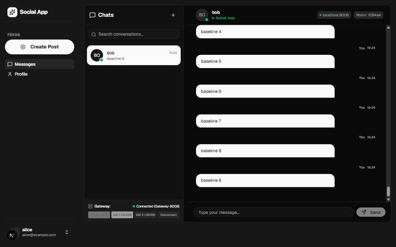
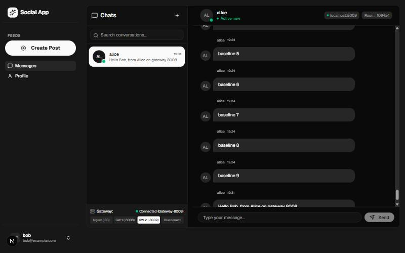
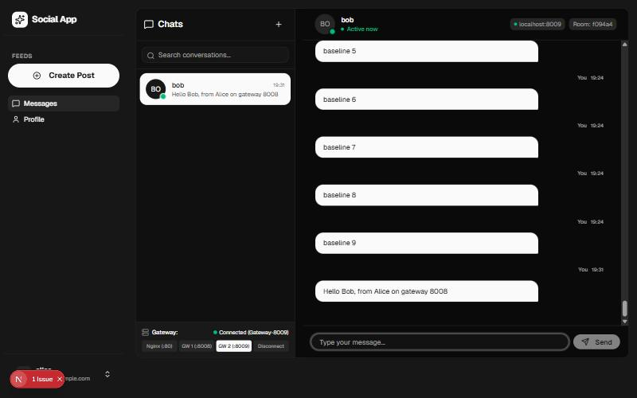
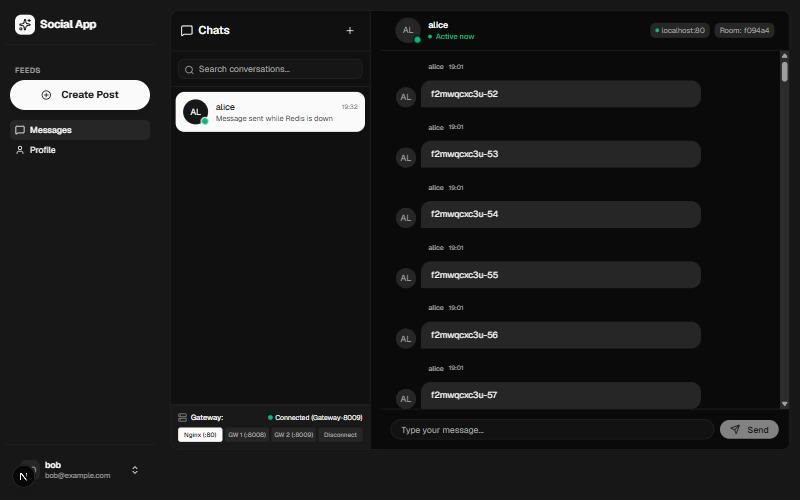
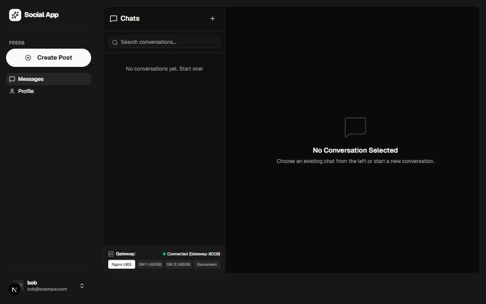
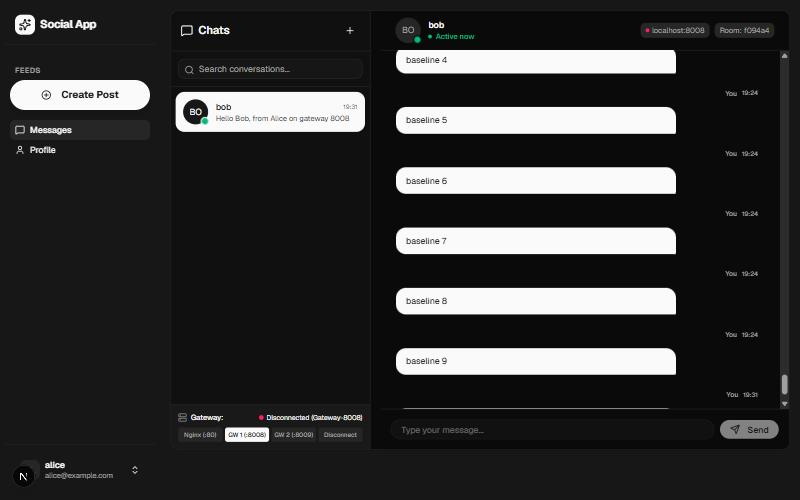
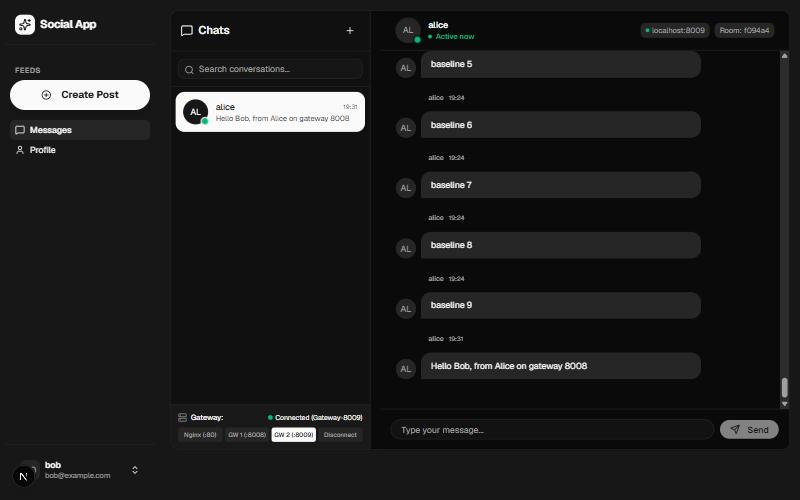
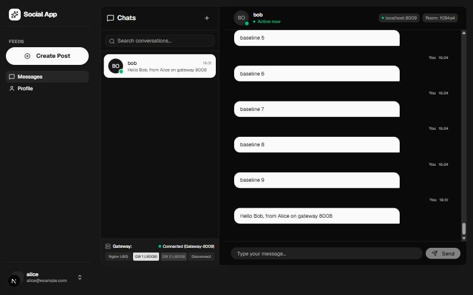
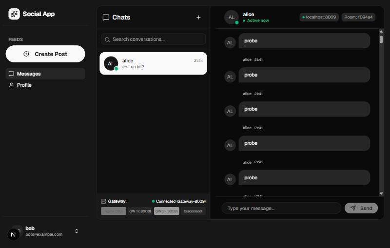
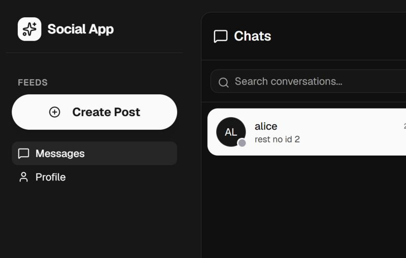

# Lỗi tìm thấy khi chạy demo

Chạy demo hai người dùng (Alice và Bob) trên hai gateway rồi gây sự cố từng thành phần để xem hệ thống hỏng ở đâu. Ảnh trong báo cáo này do mình tự chụp khi chạy lại demo bằng trình duyệt tích hợp (Alice mở ở `localhost:3000`, Bob ở `127.0.0.1:3000` để cookie tách riêng). Số liệu đo bằng script nằm trong [`scripts/`](scripts/). Cả 11 lỗi đã được sửa sau đó; kết quả chạy lại nằm ở mục [Trạng thái sửa](#trạng-thái-sửa).

## Phần đang chạy tốt

| Việc | Kết quả |
|---|---|
| Nhắn tin chéo gateway (Alice 8008 → Bob 8009) | Bob nhận ngay (ảnh ok-03). Đo bằng script: 30/30 tin, p50 ≈ 21 ms, p95 ≈ 30 ms |
| Tắt gateway rồi Alice tự bấm sang gateway còn lại, token còn hạn | Nối lại được, gửi tiếp bình thường (ảnh ok-06). Script: phát hiện 3–5 ms, nối lại 157–173 ms, 0 tin mất, 0 trùng |
| RabbitMQ chết 12 s | Mọi thao tác lỗi ngay (không treo); tự phục hồi ≈ 7,5 s sau khi bật lại |
| Tắt 1 trong 2 chat-service | 75/75 tin vẫn lưu (một lần chạy) |

| Alice nối gateway 8008 | Bob ở 8009 nhận tin của Alice |
|---|---|
|  |  |

## Các lỗi (xếp theo mức nghiêm trọng)

| # | Mức | Lỗi | Nằm ở đâu | Ảnh |
|---|---|---|---|---|
| 1 | Cao | **Redis chết làm auth-service và chat-service sập**, không tự phục hồi. Giao diện vẫn báo xanh nhưng tin gửi biến mất, không có thông báo lỗi | [redis-cache.module.ts:17-18](../apps/api/apps/api/src/common/cache/redis-cache.module.ts) (client Redis của Keyv không bắt lỗi) | loi-07, loi-08 |
| 2 | Cao | **Tin ma**: người gửi không thấy tin, nhưng tin vẫn được lưu và hiện ra sau khi dịch vụ sống lại | [ChatContainer.tsx:289](../apps/web/app/(protected)/messages/components/ChatContainer.tsx) (lỗi chỉ ghi console, ô nhập đã bị xoá) + hàng đợi RabbitMQ giữ tin | loi-10 |
| 3 | Cao | Gửi tin qua REST không kèm `clientMessageId` bị **HTTP 500** từ tin thứ hai (`E11000`) | [message.schema.ts:25,34](../apps/api/apps/chat-service/src/database/schemas/message.schema.ts) (chỉ mục `sparse` + `unique` coi thiếu mã là `null`) | không có (thấy trong log chat-service) |
| 4 | Trung | Chat-service chết thì danh sách hội thoại hiện **"No conversations yet"** thay vì báo lỗi | [ChatContainer.tsx:68](../apps/web/app/(protected)/messages/components/ChatContainer.tsx) | loi-09 |
| 5 | Trung | Tắt gateway: Bob **vẫn thấy Alice "Active now"**; socket cũ nằm mãi trong Redis nên Alice không bao giờ về offline | [presence.service.ts:32-49](../apps/api/apps/api/src/chat/gateway/presence.service.ts) (không có TTL, chỉ xoá khi socket ngắt êm) | loi-04, loi-05 |
| 6 | Trung | Đăng nhập xong bị chuyển tới **`/fyp` (404)** | [login-form.tsx:52](../apps/web/app/auth/components/login-form.tsx), [proxy.tsx:91](../apps/web/proxy.tsx) | loi-01 |
| 7 | Trung | Token JWT hết hạn thì socket bị gateway từ chối và **không tự nối lại**: ô gửi tin xám. Trước đó `/api/auth/token` đã trả token hết hạn | [token/route.ts:7](../apps/web/app/api/auth/token/route.ts), [ChatContainer.tsx:123](../apps/web/app/(protected)/messages/components/ChatContainer.tsx), [chat.gateway.ts:56,99](../apps/api/apps/api/src/chat/gateway/chat.gateway.ts) | không chụp lại được lần này (log gateway: `jwt expired`) |
| 8 | Trung | Mongo primary chết: ứng dụng không đi theo primary mới, **ghi mất ≈ 27 s** (CSDL bầu primary mới sau ≈ 10 s) | `MONGO_URI` có `directConnection=true` trong `.env` | không có |
| 9 | Trung | BFF của Next.js gọi cố định gateway 8008 theo mặc định: 8008 chết thì mọi `/api/*` trả **500** | `NEXT_PUBLIC_BACKEND_URL` mặc định 8008; đã tạm đổi qua Nginx trong `apps/web/.env.local` | không chụp lại được lần này |
| 10 | Thấp | Nginx qua Docker Desktop trả **502** ≈ 1,2% ở 100 kết nối đồng thời (mở kết nối mới tới host cho từng yêu cầu) | [nginx.conf](../nginx.conf) (không có `keepalive` cho `upstream`) | không có |
| 11 | Thấp | Cache tin nhắn chỉ bị huỷ cho `limit=100`; `limit` khác cũ tối đa 60 s | chat-service (khoá cache theo `limit`) | không có |

Số liệu kèm theo: cache cho thông lượng gấp ≈ 6,9 lần (996 so với 145 yêu cầu/giây, 50 kết nối); một gateway đạt ≈ 3.500–3.800 yêu cầu/giây ở 100–250 kết nối.

## Chi tiết từng lỗi có ảnh

### 1 và 2. Redis chết, tin biến mất, rồi "tin ma"

Alice gửi một tin ngay sau khi tắt Redis. Giao diện vẫn báo `Connected (Gateway-8009)`; tin không hiện lên và không có lời nhắn lỗi nào (chỉ có biểu tượng "1 Issue" của công cụ dev).

| Sau 3 giây | Sau 15 giây |
|---|---|
|  |  |

Phía sau: cả auth-service và chat-service đã thoát (log: `SocketClosedUnexpectedlyError … Node.js v24.19.0`), tin của Alice kẹt trong `chat_queue`. Khi bật lại Redis rồi khởi động lại hai dịch vụ (chat-service còn sập thêm một lần ngay sau khi vừa lên, nên phải khởi động lần nữa), tin được lưu. Bob mở lại trang thì thấy tin đó, trong khi Alice lúc gửi không hề thấy gì:

### 4. Chat-service chết, danh sách hội thoại trống

Bob tải lại trang khi chat-service đang chết: thay vì lỗi, giao diện báo chưa có hội thoại nào ("No conversations yet. Start one!"), dễ khiến người dùng tưởng dữ liệu bị mất.

### 5. Tắt gateway: trạng thái online sai

Gateway 8008 bị tắt lúc 19:31:50. Alice thấy `Disconnected (Gateway-8008)`, nhưng Bob vẫn thấy Alice "Active now".

| Alice | Bob |
|---|---|
|  |  |

Alice bấm sang `GW 2 (:8009)` thì nối lại được vì token còn hạn:

Sau khi sửa, cùng kịch bản: Bob thấy Alice online, tắt cứng gateway của Alice, khoảng 35 s sau chấm của Alice chuyển xám.

| Trước khi tắt | Sau khi tắt (≈ 45 s) |
|---|---|
|  |  |

### 6. Đăng nhập xong bị 404

## Trạng thái sửa

Đã sửa cả 11 lỗi và chạy lại đúng các kịch bản ở trên.

| # | Đã sửa thế nào | Chạy lại sau khi sửa |
|---|---|---|
| 1 | Cache Redis thành "có thì dùng": Redis chết thì đọc thẳng CSDL ngay, không chờ ([redis-cache.store.ts](../apps/api/apps/api/src/common/cache/redis-cache.store.ts)). Gắn bộ bắt lỗi cho mọi store của cache-manager. Gateway: `publish` của Socket.IO Redis adapter không còn làm sập tiến trình, tắt hàng đợi offline ([redis-io.adapter.ts](../apps/api/apps/api/src/common/adapter/redis-io.adapter.ts)) | `f4_f6_infra.mjs redis`: Redis chết 12 s, **0 yêu cầu lỗi** (đọc, đọc nguội, gửi tin), auth, chat và hai gateway đều sống, cache tự dùng lại khi Redis lên |
| 2 | Tin đang gửi hiện "Sending...", quá 10 s thì "Not sent" + nút Retry; gửi lại dùng đúng `clientMessageId` cũ | Ảnh sau-sua-03, 04, 05: gửi lại chỉ ra **một** bản |
| 3 | Chỉ mục `unique` + `partialFilterExpression` (chỉ áp cho tin có `clientMessageId`); trùng thì trả tin đã lưu | Test idempotency 4/4; REST gửi nhiều tin không mã không còn 500 |
| 4 | Danh sách hội thoại và tin nhắn có trạng thái lỗi riêng kèm nút "Try again" | Ảnh sau-sua-02 |
| 5 | Presence có nhịp tim: mỗi gateway làm mới socket của mình 10 s/lần, socket không được làm mới 30 s bị quét (15 s/lần) và người dùng về offline; Redis lỗi không còn làm từ chối socket ([presence.service.ts](../apps/api/apps/api/src/chat/gateway/presence.service.ts)) | `f5_presence.mjs`: tắt cứng gateway 8008 khi Alice đang nối, Bob nhận Alice **offline sau 35,7 s** (trước: không bao giờ). Trên giao diện: ảnh sau-sua-06 (Alice "Active now") và sau-sua-07 (sau khi tắt gateway, chấm của Alice chuyển xám) |
| 6 | `/fyp` → `/messages` | Ảnh sau-sua-01 |
| 7 | `/api/auth/token` không trả token đã (sắp) hết hạn, client tự refresh trước khi nối; bị gateway từ chối vì token thì refresh rồi nối lại (tối đa 3 lần); bỏ refresh trong `connect_error`; mọi lần refresh đi qua một hàm chung nên không refresh song song | Hạ thời hạn token xuống 40 s để thử, đợi hết hạn rồi chuyển sang 8009: nối được `gateway-8009` với **đúng một** lần refresh (trước: ô gửi xám, refresh lặp liên tục) |
| 8 | Mỗi mongod nghe đúng cổng nó publish (27017/27018/27019), tên thành viên đổi theo; chat-service trên máy host dùng `MONGO_HOST_MAP` để phân giải tên thành viên, `MONGO_URI` bỏ `directConnection`. Đổi tên tại chỗ bằng `rs.reconfig`, **không xoá volume** (trước và sau đều 622 tin) | `f4_f6_infra.mjs mongo 40000`: primary chết 40 s, ghi phục hồi sau **≈ 20 s** trong lúc primary cũ vẫn chết (trước: ≈ 27 s và chỉ khi primary cũ sống lại) |
| 9 | BFF mặc định gọi qua Nginx (`http://localhost:80`) | Tắt 8008, `/api/*` vẫn trả 200 |
| 10 | `keepalive 64` cho upstream, `proxy_connect_timeout 3s` | 11.467 yêu cầu/5 s, 0 lỗi |
| 11 | Chỉ cache trang tin mặc định (`limit=100`), là trang được huỷ khi có tin mới | Test cache 2/2 |

Phát sinh trong lúc sửa: `pnpm --filter api dev` theo dõi nhầm thư mục `../../dist` nên gateway 8009 không tự khởi động lại khi build lại; đã sửa thành `dist/apps/api`.

Còn lại:

- Khi Redis chết, tin chéo gateway (Alice ở 8008, Bob ở 8009) tạm không tới được người nhận; tin vẫn được lưu và hiện khi tải lại. Đây là giới hạn của việc dùng Redis làm kênh pub/sub.
- Bầu primary Mongo mất ≈ 10–12 s (thời gian chờ mặc định của MongoDB), nên vẫn có một khoảng ghi lỗi ngắn.
- Lỗi 1, 7 và 8 không có ảnh "sau sửa" vì không có thay đổi đáng thấy trên giao diện; kết quả lấy từ script và log. Lỗi 5 có ảnh sau-sua-06 và sau-sua-07.
- Bộ test web (`pnpm --filter web test`) vốn không chạy được vì `jest.config.ts` nhận nhầm object `default`; test mới cho `/api/auth/token` được chạy bằng một cấu hình tạm và qua.

## Chạy lại các script đo

Điều kiện: hạ tầng Docker đang chạy, hai gateway (8008 và 8009), auth-service, chat-service chạy, có tài khoản `alice@example.com` (`Alice@1234`) và `bob@example.com` (`Bob@12345`). Chạy từ thư mục gốc: `node report/scripts/<tên>.mjs`, ví dụ `e0_baseline.mjs 30` (độ trễ chéo gateway), `f1_gateway_kill.mjs` (tắt gateway), `f2_f3_chat_service.mjs`, `f4_f6_infra.mjs rabbitmq|redis|mongo`, `f9_cache_stale.mjs`, `p1_rest_load.mjs`. Các kịch bản này tắt tiến trình hoặc container thật. `f4_f6_infra.mjs mongo 40000` đặt thời gian sự cố là 40 s; `f5_presence.mjs` tắt cứng gateway 8008 rồi tự bật lại nó qua chế độ watch.
